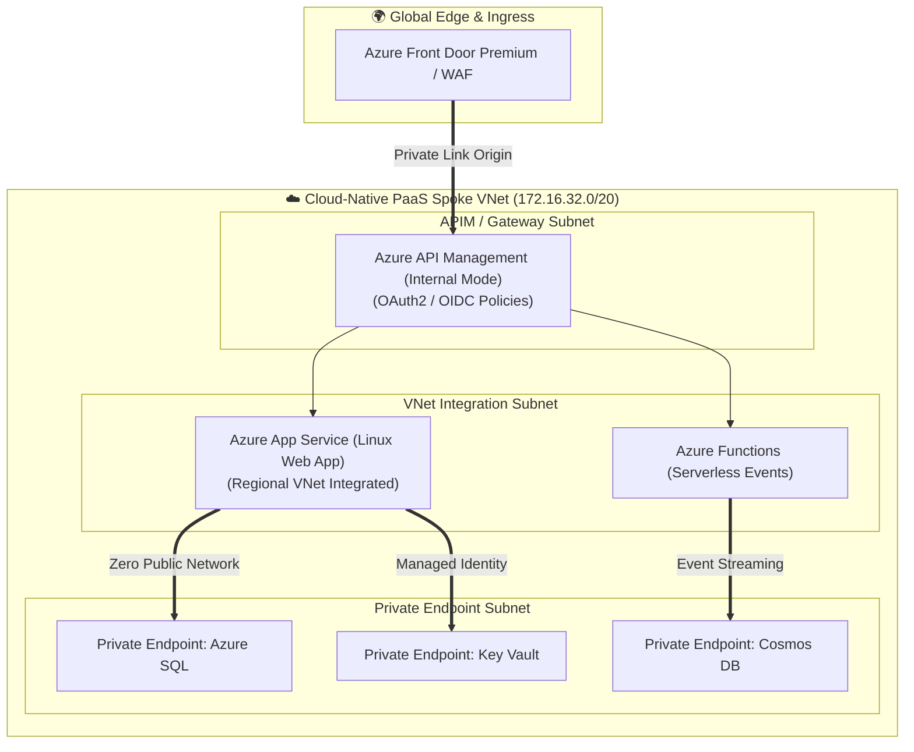

<div align="center">

  

  <p align="center">
    
    
    
    
    
  </p>

</div>

---

## 🏛️ Architecture Overview

This repository provides an **Enterprise Cloud-Native Platform-as-a-Service (PaaS) Landing Zone** designed according to Microsoft Cloud Adoption Framework (CAF) zero-trust architecture.

It eliminates public exposure by placing all PaaS services (Azure App Services, Serverless Functions, Azure SQL, Cosmos DB, and Key Vault) behind **Private Endpoints**, interconnected via **Regional VNet Integration** and fronted by **Azure API Management (APIM)**.



---

## ⚡ Key Highlights

| Pillar | Capability & Production Design |
| :--- | :--- |
| **🔒 Zero Public Access** | Every single PaaS resource has `public_network_access_enabled = false`, isolated completely inside private subnets. |
| **🌐 Regional VNet Integration** | Dedicated delegated subnet allowing App Services and Functions to call internal databases and microservices securely. |
| **🔑 Passwordless Identity** | Managed Identities (System-Assigned & User-Assigned) eliminate all hardcoded database credentials and API secrets. |
| **🚦 Enterprise API Gateway** | Azure API Management (APIM) in Internal VNet mode enforcing rate limiting, JWT token validation, and API versioning. |
| **💾 Multi-Model Data Tier** | Azure SQL Database and Azure Cosmos DB with automated failover and customer-managed encryption keys. |
| **🔄 Automated CI/CD** | Full DevSecOps pipeline with Terraform linting, Checkov compliance audit, and automated validation. |

---

## 📁 Repository Structure

```text
Enterprise-Azure-PaaS-Landing-Zone/
├── .github/workflows/
│   └── devsecops-ci-cd.yml       # DevSecOps Pipeline: Lint, SAST, Infracost, Plan
├── terraform/
│   ├── modules/
│   │   ├── paas_network/         # Spoke VNet, Subnet Delegation, Private DNS
│   │   ├── paas_compute/         # App Service Plan, Linux Web App, Function App
│   │   └── paas_data/            # Azure SQL, Cosmos DB, Key Vault, Private Endpoints
│   └── environments/
│       └── prod/
│           ├── main.tf           # Root Orchestrator
│           ├── variables.tf
│           ├── terraform.tfvars
│           └── versions.tf
└── README.md
```

---

## 🚀 Quick Start & Deployment

### Prerequisites
* Terraform `>= 1.5.0`
* Azure CLI `>= 2.50.0`
* Active Azure Subscription

### Local Execution

```bash
cd terraform/environments/prod

# Initialize Terraform modules
terraform init

# Validate syntax
terraform validate

# Review plan
terraform plan

# Apply infrastructure
terraform apply -auto-approve
```

---

## 👤 Author
**Raghvendra Singh**  
Lead DevSecOps Architect & Enterprise Cloud Strategist  
GitHub: [@raghvendrasingh-devops](https://github.com/raghvendrasingh-devops)  
LinkedIn: [raghvendra-singh-devops](https://linkedin.com/in/raghvendra-singh-devops)
